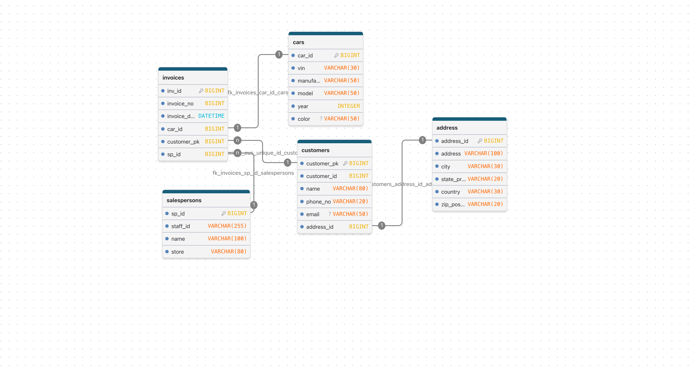

# Challenge 1 - Database Design

## Tables
- cars (car_id PK, vin, manufacturer, model, year, color)
- customers (customer_pk PK, customer_id, name, phone_no, email, address_id FK)
- address (address_id PK, address, city, state_province, country, zip_postal)
- salespersons (sp_id PK, staff_id, name, store)
- invoices (inv_id PK, invoice_no, invoice_date, car_id FK, customer_pk FK, sp_id FK)

## Relationships
- One customer has one address (customers.address_id -> address)
- One car can appear on many invoices (invoices.car_id -> cars)
- One customer can have many invoices (invoices.customer_pk -> customers)
- One salesperson can have many invoices (invoices.sp_id -> salespersons)
